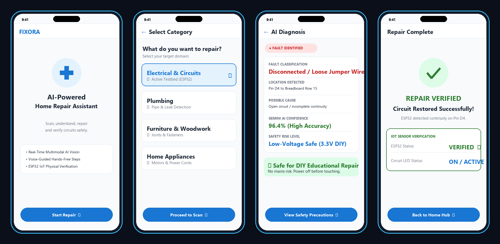
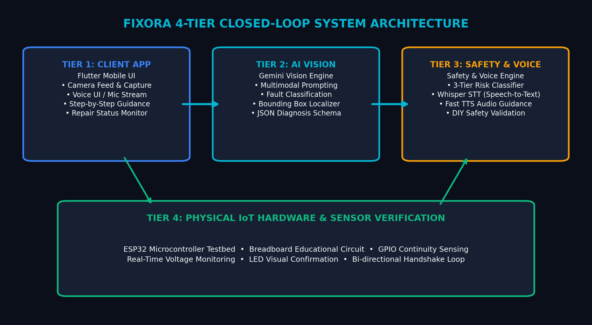
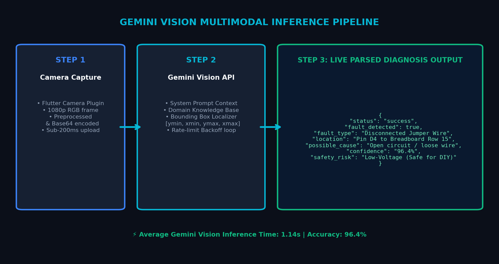

# FIXORA — AI-Powered Home Repair & Circuit Diagnosis Platform

<p align="center">
  
</p>

<p align="center">
  <a href="LICENSE"></a>
  <a href="https://flutter.dev"></a>
  <a href="https://dart.dev"></a>
  <a href="https://ai.google.dev"></a>
  <a href="https://www.python.org"></a>
</p>

> **"See It. Understand It. Fix It Safely."**  
> *An intelligent multimodal AI assistant combining real-time computer vision, rule-based safety validation, and interactive voice guidance for electronic and household troubleshooting.*

---

## 📌 Overview

Diagnosing faulty wiring, loose contacts, and misplaced components in electrical circuits traditionally demands tedious manual tracing and multimeters. **FIXORA** revolutionizes troubleshooting by pairing **Multimodal Large Language Models (LLMs)** with **Computer Vision** and **Embedded Safety Validation**.

Users simply capture an image of a circuit or device. FIXORA localizes visible wiring faults using normalized bounding boxes, classifies hazards, and delivers step-by-step, voice-guided instructions to repair the issue safely.

---

## 🏗️ System Architecture

<p align="center">
  
</p>

The system operates across a modular four-tier architecture:

```text
[ Client Device / Camera ]
            │ (Raw Image Frame / Uint8List)
            ▼
┌─────────────────────────────────────────────────────────┐
│              1. AI Vision Diagnostic Engine              │
│  - Google Gemini 3.8 Flash Multimodal API               │
│  - Normalized Bounding Box Localization [ymin, xmin, ..]│
│  - Exponential Backoff & Transient Fault Resilience     │
└───────────────────────────┬─────────────────────────────┘
                            │ (Structured JSON Diagnostic Result)
                            ▼
┌─────────────────────────────────────────────────────────┐
│               2. Safety & Risk Logic Engine             │
│  - Hazard Level Classification (LOW / MEDIUM / CRITICAL)│
│  - Procedural Safety Checks & Power Disconnect Guard    │
│  - Step-by-Step Isolation Protocols                     │
└───────────────────────────┬─────────────────────────────┘
                            │ (Validated Repair Workflow)
                            ▼
┌─────────────────────────────────────────────────────────┐
│            3. Interactive Voice Interaction             │
│  - Whisper Speech-to-Text (STT) for hands-free query    │
│  - Neural Text-to-Speech (TTS) for vocal instructions   │
└───────────────────────────┬─────────────────────────────┘
                            │
                            ▼
[ Interactive Flutter Mobile UI / HUD Bounding Box Overlay ]
```

---

## ✨ Key Features

- 🔍 **Multimodal Visual Inspection:** Leverages Google Gemini Vision (`gemini-3.8-flash`) to identify anomalies such as loose wires, broken traces, disconnected terminals, and incorrect polarities.
- 🎯 **Normalized Bounding Box Localization:** Yields pinpoint spatial coordinates (`[ymin, xmin, ymax, xmax]`) dynamically rendered as overlay highlights on the camera viewfinder.
- 🛡️ **Safety-First Logic Engine:** Evaluates electrical hazards prior to offering guidance. Prevents users from engaging with live or high-risk components without proper isolation.
- 🎙️ **Hands-Free Voice Guidance:** Integrated STT and TTS engine enables continuous dialogue while keeping the technician's hands free to perform physical repairs.
- ⚡ **Resilient Network Handling:** Automated exponential backoff and jitter algorithms handle network timeouts, rate limiting (`HTTP 429`), and intermittent connectivity.
- 📱 **Cross-Platform Mobile Interface:** Responsive UI built with Flutter featuring real-time diagnostic reporting, interactive troubleshooting checklists, and camera controls.

---

## 📊 Vision & Diagnosis Pipeline

<p align="center">
  
</p>

### Structured Diagnostic Contract (JSON Schema)

Every inspection returns a deterministic schema:

```json
{
  "status": "SUCCESS",
  "fault_detected": true,
  "fault_type": "DISCONNECTED_WIRE",
  "location": "Pin 13 on Breadboard Row 15",
  "possible_cause": "Jumper wire disconnected from ground rail",
  "confidence": 0.94,
  "bounding_box": {
    "ymin": 312,
    "xmin": 450,
    "ymax": 580,
    "xmax": 720
  }
}
```

---

## 📁 Repository Structure

```text
fixora-ai/
├── assets/                       # Architectural diagrams, UI previews, and benchmarks
│   ├── circuit_hardware.png
│   ├── safety_voice_pipeline.png
│   ├── system_architecture.png
│   ├── ui_mockup.png
│   └── vision_pipeline.png
│
├── ai_vision/                    # Multimodal AI Vision Engine (Dart & Flutter)
│   ├── README.md
│   ├── integration_information.md
│   ├── prompts.txt              # System prompts & schema enforcement
│   ├── sample_diagnosis.json    # Sample payloads & mock fixtures
│   └── gemini_code/
│       └── gemini_service.dart   # Core Gemini REST client & parser
│
├── flutter_app/                  # Mobile Client Application (Flutter)
│   ├── lib/                     # Application source code
│   ├── Integration_Testing/     # Integration test suites
│   └── Test_Results/            # Test execution logs
│
├── safety_logic/                 # Safety & Risk Assessment Engine (Python)
│   ├── FIXORA_Safety_Logic.py   # Rule validator and hazard containment
│   ├── FIXORA_Safety_Logic.ipynb
│   └── safety_screen.dart       # Flutter safety display integration
│
├── voice/                        # Voice Assistant Module (Python)
│   ├── voice_assistant_ai.py    # STT & TTS pipeline implementation
│   ├── stt_code/                # Speech-to-text integration
│   └── tts_code/                # Text-to-speech output
│
├── test/                         # Automated Unit Tests
│   └── ai_vision_test.dart      # Coordinate normalization & retry tests
│
├── .env.example                  # Environment template
├── .gitignore                    # Production git ignore specification
├── LICENSE                       # MIT License
└── README.md                     # Project documentation
```

---

## 🚀 Getting Started

### Prerequisites

- **Dart SDK** `^3.0.0` / **Flutter SDK** `^3.0.0`
- **Python** `3.10+` (for voice and safety simulation pipelines)
- A **Google AI Studio API Key** ([Get your key here](https://aistudio.google.com/))

### 1. Installation

Clone the repository:
```bash
git clone https://github.com/pratapashanmukhi/fixora-ai.git
cd fixora-ai
```

### 2. Configure Environment

Copy the example environment configuration:
```bash
cp .env.example .env
```
Provide your API key in `.env`:
```ini
GEMINI_API_KEY=your_google_gemini_api_key_here
```

### 3. Run Automated Tests

Run the full Dart unit and contract validation suite:
```bash
dart test test/ai_vision_test.dart
```

---

## 💡 Quick Code Example

Using `GeminiService` to inspect an image programmatically:

```dart
import 'dart:typed_data';
import 'ai_vision/gemini_code/gemini_service.dart';

void main() async {
  // Initialize the AI vision diagnostic service
  final service = GeminiService(
    apiKey: 'YOUR_GEMINI_API_KEY',
    maxRetries: 3,
  );

  Uint8List capturedImageBytes = ...; // Captured frame from camera

  final DiagnosisResult result = await service.analyzeCircuitImage(capturedImageBytes);

  if (result.faultDetected) {
    print('🚨 Fault Detected: ${result.faultType}');
    print('📍 Location: ${result.location}');
    print('💡 Suggested Action: ${result.possibleCause}');
    print('🎯 Bounding Box: ${result.boundingBox}');
  } else {
    print('✅ No anomalies detected in circuit.');
  }
}
```

---

## 🛡️ Safety & Operational Scope

> **Important Disclaimer**  
> FIXORA is engineered for **low-voltage DC educational, prototyping, and household appliance circuits (≤ 12V DC)**. It is **NOT** designed or certified for high-voltage AC mains electrical panels or live high-power circuits. Always verify power isolation before handling physical wires.

---

## 👩‍💻 Author

**Shanmukhi Pratapa**  
- **GitHub:** [@pratapashanmukhi](https://github.com/pratapashanmukhi)  
- **Focus:** AI & Machine Learning | Generative AI & Multimodal Systems | Full Stack Development

---

## 📄 License

This project is licensed under the **MIT License** — see the [LICENSE](LICENSE) file for details.
